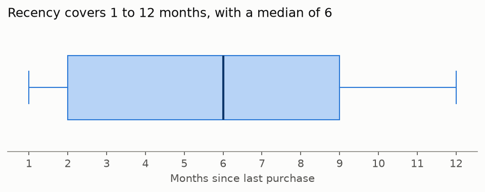
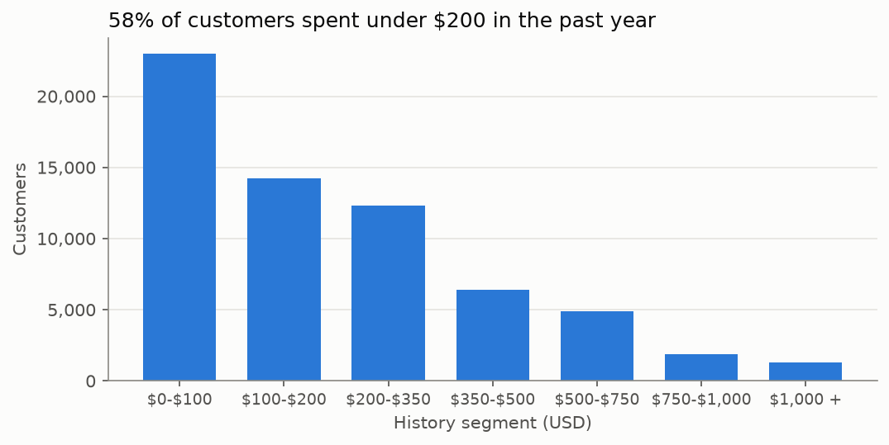
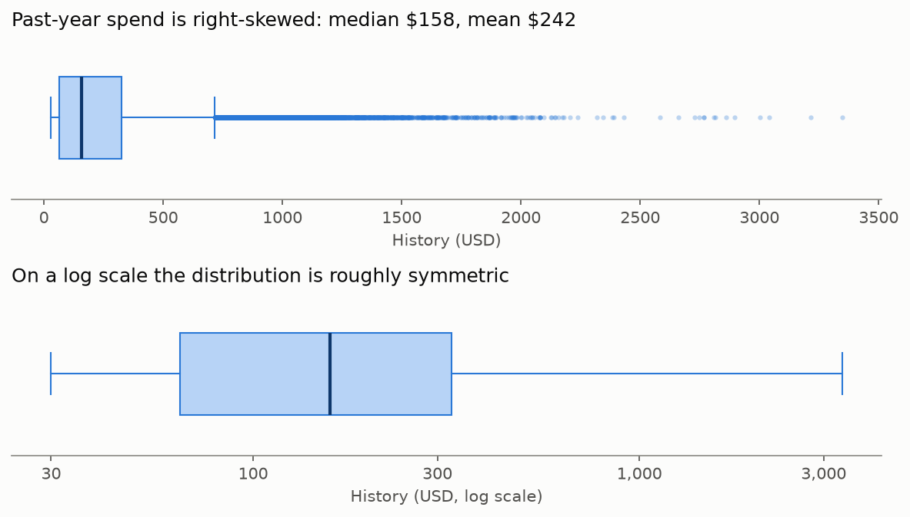
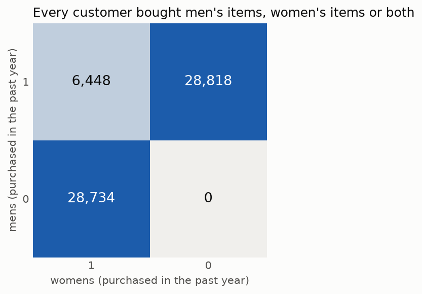
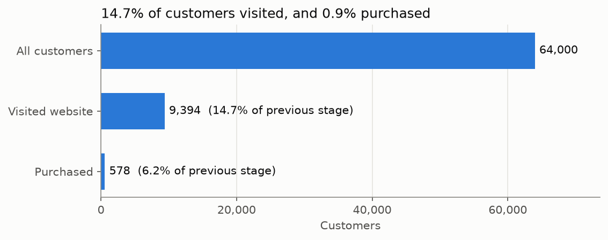
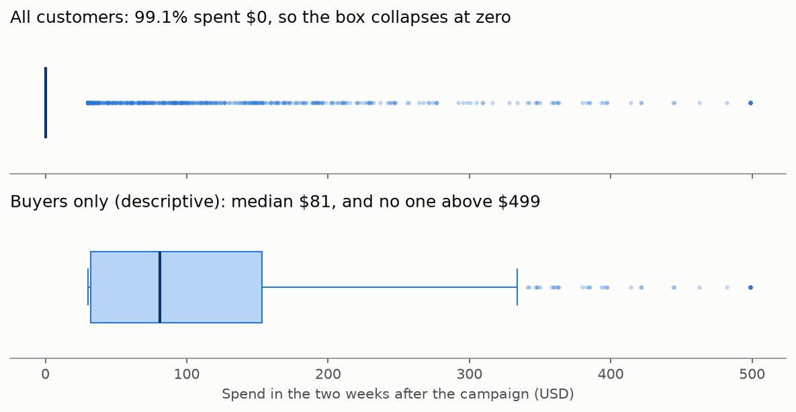

# Exploratory Data Analysis Summary

This is a first description of the data. It uses overall figures only: the experiment groups and customer segments are not compared on outcomes, so **nothing here measures whether the emails worked**. All numbers and figures come from [`notebooks/00_01_eda.ipynb`](../notebooks/00_01_eda.ipynb).

## Data quality

**The data is largely usable as supplied, but it needs some handling.**

- **Missing values:** there are none.
- **Misspelling:** "Suburban" is spelled `Surburban` in every suburban row.
- **Repeated rows:** 6,562 rows exactly repeat an earlier row. All of them have zero spend, and 99.5% have `history` at its minimum of $29.99. With no customer ID, they cannot be told apart from different customers who share the same values, so **they are kept**. Removing them would change the results: conversion would rise from 0.903% to 1.006%.
- **Outcome logic:** the three outcomes are consistent. Every purchase comes with a website visit, and spend is above zero exactly when `conversion` is 1.
- **Group sizes:** the three groups have 21,387, 21,307 and 21,306 customers. A formal sample-ratio test is in the [experiment validity checks](00_02_experiment_validity.md).

## Customers before the campaign

**Recency.** The median customer last purchased 6 months ago, and **the middle 50% of customers fall between 2 and 9 months**.

**Past-year spend.** **58% of customers spent under $200 in the past year.** The median is $158 and the mean is $242, because a small group of high spenders pulls the mean up. The skewness of 2.42 falls to about 0 after a log transform, so **the distribution is roughly symmetric on a log scale**. 12.4% of customers sit exactly at the minimum of $29.99.

**Past-year purchases.** 45.0% of customers bought only men's merchandise, 44.9% only women's, and 10.1% (6,448 customers) bought both. **No customer bought neither**, which is consistent with the dataset covering only customers who purchased within the past twelve months.

**Unexplained pattern at $200 (added on November 9, 2026).** **No customer with past-year spend under $200 bought both men's and women's merchandise.** Among the 6,448 who bought both, the lowest past-year spend is $200.13, held by one customer, and 203 customers fall between $200 and $210, about as many as between $210 and $220. Below $200, all 37,224 customers bought only one line. Customer behavior alone would be unlikely to produce such a sharp boundary, so it may reflect how the dataset was built, but **the cause is unknown**. It does not affect the experiment, because the email groups are balanced on both columns. The check is in [`notebooks/03_01_targeting_rule.ipynb`](../notebooks/03_01_targeting_rule.ipynb), where the pattern was found.

## Behavior after the campaign

These figures pool all three groups, including customers who received no email.

**Funnel.** **14.7% of customers visited the website in the two weeks after the campaign, and 0.9% purchased.** Of those who visited, 6.2% purchased.

**Spend.** **99.1% of customers spent nothing, so average spend rests on only 578 buyers.** Among buyers, the median is $80.80 and the mean is $116.36. This buyer-only view is descriptive: comparing groups among buyers alone would break the randomization, because the email may affect who buys.

**Unexplained pattern at $499.** Spend stops at exactly $499 for 12 buyers, with no values above it and the next highest at $482.31. Apart from the $29.99 minimum (136 buyers), no other amount appears more than twice. This could reflect a cap on recorded spend or a fixed price, but the data description does not mention either, so **the cause is unknown**.
