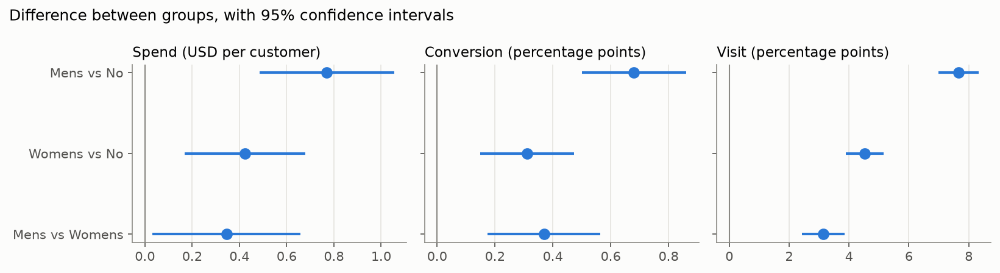

# Questions 1 and 2: Which Email Performed Best, and How Much Did It Add?

## Questions

1. **Which e-mail campaign performed the best, the Mens version, or the Womens version?**
2. **How much incremental sales per customer did the Mens version of the e-mail campaign drive? How much incremental sales per customer did the Womens version of the e-mail campaign drive?**

These are quoted from the original challenge.

## Approach

The methods below were **fixed in the [analysis plan](../analysis_plan.md) before any group outcomes were viewed**. The code is in [`notebooks/01_01_average_effects.ipynb`](../notebooks/01_01_average_effects.ipynb).

- **Who is compared:** all 64,000 customers, in the group they were assigned to.
- **Primary metric:** `spend`, the difference in mean spend per customer over the two weeks after the campaign.
- **Main test:** Welch t-test with a 95% confidence interval, checked against a bootstrap confidence interval because 99.1% of customers spent nothing.
- **Multiple testing:** Holm correction across the three spend comparisons.
- **Secondary metrics:** `visit` and `conversion`, used to check that conclusions are consistent.

## Answers

**Question 1: the Mens email performed best.** It raised spend, visits and conversion more than the Womens email. Its lead on spend is significant but imprecisely estimated: the confidence interval for the difference runs from $0.03 to $0.66.

**Question 2: the Mens email added about $0.77 per customer, and the Womens email about $0.42,** compared with $0.65 per customer in the No E-Mail group. Percentage increases would look very large because of this low baseline, so this report uses dollar amounts, which also feed directly into the profit calculation.

**These results do not depend on the method.** Welch and bootstrap confidence intervals differ by less than $0.01, and all three comparisons remain significant after the Holm correction.

## Spend (primary metric)

| Comparison          | Difference per customer | Welch 95% CI   | Bootstrap 95% CI | Holm-adjusted p |
| ------------------- | ----------------------: | -------------- | ---------------- | --------------: |
| Mens vs No E-Mail   |                  +$0.77 | $0.49 to $1.05 | $0.49 to $1.06   |         < 0.001 |
| Womens vs No E-Mail |                  +$0.42 | $0.17 to $0.68 | $0.17 to $0.69   |           0.002 |
| Mens vs Womens      |                  +$0.35 | $0.03 to $0.66 | $0.03 to $0.67   |           0.031 |

## Visit and conversion (secondary metrics)

| Comparison          | Visit rate difference (95% CI) | Conversion rate difference (95% CI) |
| ------------------- | ------------------------------ | ----------------------------------- |
| Mens vs No E-Mail   | +7.66 pp (7.00 to 8.32)        | +0.68 pp (0.50 to 0.86)             |
| Womens vs No E-Mail | +4.52 pp (3.89 to 5.16)        | +0.31 pp (0.15 to 0.47)             |
| Mens vs Womens      | +3.14 pp (2.43 to 3.84)        | +0.37 pp (0.17 to 0.56)             |

pp = percentage points: the difference between two rates, such as a visit rate of 18.28% in the Mens group minus 10.62% in the No E-Mail group. **Both secondary metrics point in the same direction as spend.** As set out in the plan, they are not corrected for multiple testing.

## Supplementary: regression adjustment

This check was not in the analysis plan. I added the pre-treatment customer features to a regression of spend on the two email indicators. **The estimates changed by less than $0.01, which is consistent with the groups being balanced. The confidence intervals narrowed by less than 0.2%,** because the features explain only 0.1% of the variation in individual spend. The unadjusted Welch estimates therefore remain the main results. The code is in [`notebooks/01_02_regression_adjustment.ipynb`](../notebooks/01_02_regression_adjustment.ipynb).

## Limitations

- **Effect of assignment, not of reading the email:** the data has no delivery or open records, so these figures describe the effect of being assigned to receive an email.
- **Possible cap on spend:** spend stops at exactly $499 for 12 buyers (6 in the Mens group, 4 in the Womens group and 2 in the No E-Mail group). If spend was capped, high spenders are undercounted. Because more of these buyers received an email, the effects above may understate the true effects. The data cannot confirm whether a cap exists.
- **Short window:** outcomes cover only two weeks, so longer-term effects are not measured.
- **Known dataset:** this dataset is widely used for teaching, and the finding that the Mens email performed better is not new.
