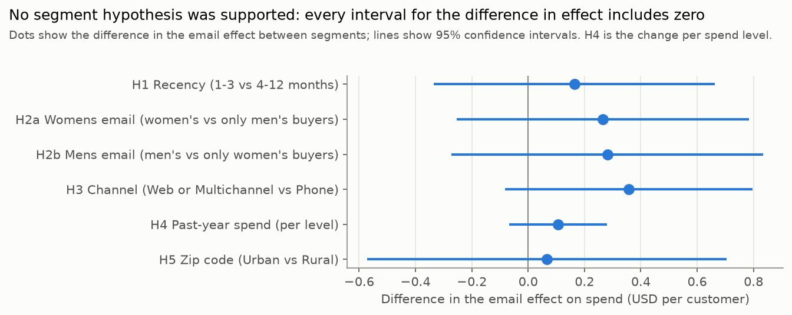

# Questions 5, 6 and 8: For Whom Did the Emails Work Better?

## Questions

5. **Did the Mens version of the e-mail campaign perform different than the Womens version of the e-mail campaign, across various customer segments?**
6. **Did the campaigns perform different when measured across different metrics, like Visitors, Conversion, and Total Spend?**
8. **Which audience would you target the Mens version to, and the Womens version to, given the results of the test? What data do you have to support your recommendation?**

These are quoted from the original challenge.

## Approach

The six segment hypotheses and their methods were **fixed in the [analysis plan](../analysis_plan.md) before any group outcomes were viewed**. The code is in [`notebooks/02_01_segment_effects.ipynb`](../notebooks/02_01_segment_effects.ipynb).

- **What is tested:** whether the effect of email on `spend` differs between two customer segments. Each hypothesis is one OLS regression with an interaction term and robust (HC3) standard errors. **The interaction is the difference in the email effect between the segments, and its p-value decides the hypothesis.**
- **Which emails:** the Mens and Womens groups are pooled, except in H2, which tests each email on customers whose past purchases match it.
- **Multiple testing:** Holm correction across the six spend interactions.
- **Secondary metrics:** `visit` and `conversion`, reported to check consistency. They are not corrected and are not used to claim significance.

## Answers

**No segment hypothesis was supported.** For all six, the confidence interval for the difference in effect includes zero, both before and after the Holm correction. **The email raised spend in almost every segment, and the data cannot show that it worked better in any of them.** This does not mean the effects are equal: the intervals are wide enough to include differences of several tens of cents per customer.

**Question 5: the two emails show different patterns, but the difference was not tested directly.** The Mens email raised spend for customers who bought men's merchandise (+$0.90) and for those who bought only women's (+$0.62), with no significant difference between them. The Womens email's extra visits and purchases were concentrated among customers who bought women's merchandise. This contrast comes from comparing two separate tests, so it is descriptive only.

**Question 6: yes, for the Womens email.** Among customers who bought women's merchandise, the Womens email raised visits by 6.2 percentage points more, and conversion by 0.45 points more, than among customers who bought only men's. The confidence intervals for both differences exclude zero. These are secondary metrics and are not corrected for multiple testing, so they are reported as supporting evidence rather than confirmed findings. The difference in spend (+$0.27) is not significant, because spend varies far more between customers. For the Mens email and the other four hypotheses, the three metrics lead to the same conclusion.

**Question 8, provisional: send the Mens email broadly. If the Womens email is used, send it to customers who bought women's merchandise.** The Mens email worked in both past-purchase groups. The Womens email raised spend significantly for women's buyers (+$0.54). For customers who bought only men's, its effect on spend (+$0.28) cannot be distinguished from zero, and its effects on visits and conversion were much smaller. This recommendation therefore rests partly on secondary metrics. Whether the Mens email also beats the Womens email among women's buyers was not tested here. The final rule, with costs and margins, is set in stage 03.

## The six segment tests (spend)

| Hypothesis | Effect in the comparison segment | Effect in the predicted segment | Difference in effect (95% CI) | p | Holm p |
| --- | ---: | ---: | --- | ---: | ---: |
| H1 Recency: 1-3 vs 4-12 months | +$0.54 | +$0.70 | +$0.16 (-$0.33 to $0.66) | 0.52 | 1.00 |
| H2a Womens email: women's vs only men's buyers | +$0.28 | +$0.54 | +$0.27 (-$0.25 to $0.78) | 0.32 | 1.00 |
| H2b Mens email: men's vs only women's buyers | +$0.62 | +$0.90 | +$0.28 (-$0.27 to $0.83) | 0.32 | 1.00 |
| H3 Channel: Web or Multichannel vs Phone | +$0.40 | +$0.75 | +$0.36 (-$0.08 to $0.80) | 0.11 | 0.67 |
| H4 Past-year spend, per level | +$0.58 (level 1) | +$1.31 (level 5) | +$0.11 per level (-$0.07 to $0.28) | 0.23 | 1.00 |
| H5 Zip code: Urban vs Rural | +$0.64 | +$0.70 | +$0.07 (-$0.57 to $0.70) | 0.84 | 1.00 |

Effects are the extra spend per customer from email over the two weeks after the campaign. For H4, the segment effects are estimated within level 1 and level 5, and the difference is the change per level from a straight line across all five levels.

**All six estimates are positive, in the direction each hypothesis predicted, but this is not counted as evidence.** The tests share customers, so their signs are not independent, and none of the intervals excludes zero.

## Product match by metric (H2)

| Email and metric | Bought only the other line | Bought the matching line | Difference in effect (95% CI) | p |
| --- | ---: | ---: | --- | ---: |
| Womens email, spend | +$0.28 | +$0.54 | +$0.27 (-$0.25 to $0.78) | 0.32 |
| Womens email, conversion | +0.06 pp | +0.51 pp | +0.45 pp (0.13 to 0.77) | 0.006 |
| Womens email, visit | +1.1 pp | +7.3 pp | +6.2 pp (5.0 to 7.5) | < 0.001 |
| Mens email, spend | +$0.62 | +$0.90 | +$0.28 (-$0.27 to $0.83) | 0.32 |
| Mens email, conversion | +0.57 pp | +0.77 pp | +0.20 pp (-0.16 to 0.56) | 0.28 |
| Mens email, visit | +7.1 pp | +8.2 pp | +1.1 pp (-0.2 to 2.4) | 0.10 |

pp = percentage points. **The Womens email drew far more visits from women's buyers than from men's buyers, while the Mens email drew similar visits from both.** Spend p-values for H2a and H2b become 1.00 after the Holm correction; the conversion and visit p-values are not corrected.

## Descriptive checks

- **Past-year spend levels (H4):** the effect within each level was +$0.58, +$0.58, +$0.10, +$0.72 and +$1.31 from level 1 (under $100) to level 5 ($500 or more). **The dip at level 3 is within random variation,** and the level 5 estimate is likely overstated, because the largest of several noisy estimates tends to be too high. I kept the planned straight-line test rather than switching to separate levels after seeing these figures (see [`DECISIONS.md`](../DECISIONS.md)).
- **Effect per $100 of past-year spend (H4):** $1.13 at level 1, falling to $0.17 at level 5, because past spend rises about 15 times across the levels while the effect rises about twice. **Because each email costs the same, the targeting rule will rank customers by dollars per customer, not by this ratio.**
- **Suburban customers (H5):** left out of the test as planned. The email raised their spend by +$0.49 (95% CI $0.15 to $0.83).

## Limitations

- **Interactions need large samples:** a difference between two effects is estimated far less precisely than either effect alone. With 64,000 customers, most intervals are about $1 wide, so "not supported" means the data cannot detect a difference, not that the effects are equal.
- **Pooled emails:** H1 and H3 to H5 estimate the average effect of the two emails in each segment. A segment that responds to only one of the emails would show a smaller difference than it has for that email.
- **Effect of assignment, not of reading the email:** the data has no delivery or open records.
- **Possible cap on spend and a short window:** as in the [average effects report](01_01_average_effects.md), spend stops at $499 for 12 buyers, and outcomes cover only two weeks.
- **Known dataset:** this dataset is widely used for teaching, and these results are not new findings.
