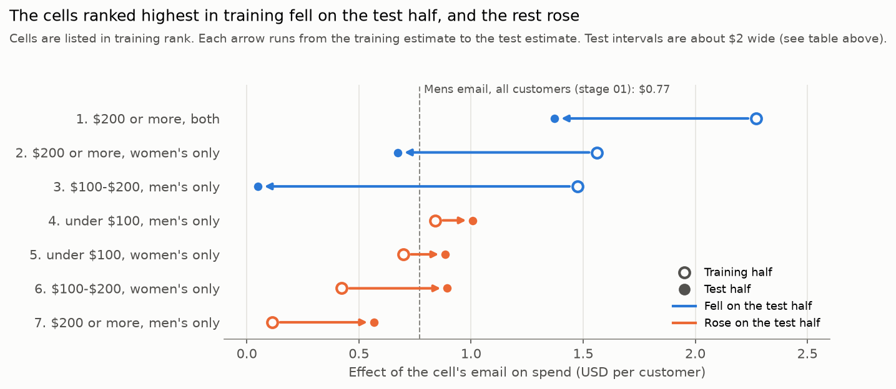

# Questions 3 and 4: Whom Should We Email, and Whom Should We Leave Out?

## Questions

3. **If you could only send an e-mail campaign to the best 10,000 customers, which customers would receive the e-mail campaign? Why?**
4. **If you had to eliminate 10,000 customers from receiving an e-mail campaign, which customers would you suppress from the campaign? Why?**

These are quoted from the original challenge.

## Approach

Every choice below was **fixed before the rule was evaluated on held-out data**. The reasons are summarized here; the dated discussion behind each one is in [`DECISIONS.md`](../DECISIONS.md) (2026-11-03 to 2026-11-11), and the code is in [`notebooks/03_01_targeting_rule.ipynb`](../notebooks/03_01_targeting_rule.ipynb).

1. **Cells:** customers are grouped by past-year spend and past purchases (men's only, women's only, or both).
   - **Why these two:** past purchases decide which email to send, which challenge question 8 asks about, and past-year spend is the most direct measure of customer value. Recency, channel and zip code are left to the uplift models in stage 04, because crossing more variables would leave most cells with a few hundred customers.
   - **Why three spend levels:** each cell needs at least 1,000 customers in each email group of the training half. With fewer, the standard error of an effect would exceed about $0.67, and the 95% interval would span more than ±$1.30, wider than the average effect of about $0.50. The five spend levels used in stage 02 were therefore merged into under $100, $100-$200 and $200 or more, using customer counts only.
   - **Why seven:** nobody under $200 bought both lines (see the [EDA summary](00_01_eda_summary.md)), so the "both" group exists only at $200 or more.
2. **Split:** the data is split 50:50, stratified by assigned email group, with seed 42. The rule is built on the training half and judged on the test half, and stage 04 uses the same split so that the models and the rule are judged on the same customers.
   - **Why not 80:20:** in prediction, the test set only checks accuracy. Here it must estimate the email effect among about 5,000 selected customers. With 20%, only about 2,000 test customers would be selected, too few to tell the rule from random selection.
3. **Estimates:** in each cell, one regression of spend on the two emails, with robust (HC3) standard errors, estimates both email effects on the training half. **Each cell receives the email with the higher point estimate.** A choice has to be made either way, so the higher estimate is the better bet, even when the difference is not significant.
4. **Ranking:** cells are ranked by that effect in dollars per customer, because every email costs the same and what matters is the extra spend each one brings in. The 10,000 to email are taken from the top and the 10,000 to suppress from the bottom. Where the count runs out partway through a cell, the customers are sampled at random (seed 42), because the rule treats everyone in a cell the same.
5. **Threshold:** **the rule replaces the simpler choice of sending the Mens email to a random 10,000 only if the 95% bootstrap interval for the difference, rule minus baseline, lies entirely above zero.** An interval that merely excluded zero would also be met if the rule were clearly worse. The baseline is an actual random sample of 10,000 (seed 42), as a marketing team would otherwise send. The suppression list is judged the same way against suppressing that random 10,000. The bootstrap resamples the test half 10,000 times with seed 42.

**Incremental spend per selected customer** is the mean spend of selected customers who received the email the list would send, minus the mean spend of selected customers who received no email.

## Answers

**The emails pay off, and sending the Mens email broadly works as well as any segment rule tested.** The rule did not pass its threshold for either question, so the recommendation falls back to the baseline.

**Question 3: send the Mens email. The data does not show which 10,000 customers would respond best.** The rule selected all 6,448 customers with $200 or more of past-year spend who bought both lines, plus 3,552 of those with $200 or more who bought only women's merchandise. On the test half, they gained $1.13 each, against $1.01 for a random 10,000 sent the Mens email. **The difference, $0.12, has a 95% interval from -$1.25 to $1.43, so the rule is not shown to be better.** It is not shown to be worse either: the test half is too small to separate differences this small.

**Question 4: no list of 10,000 was shown to cost less to suppress than a random 10,000.** The rule's list was 10,000 of the 10,178 customers with $200 or more of past-year spend who bought only men's merchandise, where the Mens email's training estimate was lowest ($0.11). On the test half, suppressing them gave up $0.57 per customer, against $1.13 for random suppression, but **the interval for the difference runs from -$1.03 to $2.27**. If customers must be suppressed, random suppression is as well supported as any list tested.

**Sending to more customers may pay more than suppressing any.** Every cell's test estimate is above the $0.02 per customer needed to cover an email, at the assumed 40% margin and $0.008 per email. These costs are assumptions, and stage 06 tests other values.

## Results on the test half

| List | Test customers | Incremental spend per customer (95% CI) |
| --- | ---: | --- |
| Rule: top 10,000 | 5,017 | +$1.13 ($0.15 to $2.15) |
| Baseline: Mens email to a random 10,000 | 4,920 | +$1.01 (-$0.02 to $2.17) |
| Random 10,000, random email | 4,920 | +$0.65 (-$0.29 to $1.63) |
| **Rule minus baseline** | | **+$0.12 (-$1.25 to $1.43)** |
| Rule minus random 10,000, random email | | +$0.48 (-$0.75 to $1.72) |
| Suppressed by the rule (spend given up) | 4,998 | +$0.57 (-$0.88 to $1.94) |
| Suppressed at random (spend given up) | 4,920 | +$1.13 ($0.07 to $2.32) |
| **Random minus rule's suppression** | | **+$0.56 (-$1.03 to $2.27)** |

The baseline's $1.01 is above the Mens email's overall effect of $0.77 in [stage 01](01_01_average_effects.md). Its interval includes $0.77, so the gap is consistent with the sampling noise of about 4,900 customers.

## Why the rule did not hold up

| Training rank | Cell | Email | Training effect | Test effect (95% CI) |
| ---: | --- | --- | ---: | --- |
| 1 | $200 or more, both | Mens | +$2.27 | +$1.37 (-$0.03 to $2.78) |
| 2 | $200 or more, women's only | Mens | +$1.56 | +$0.67 (-$0.06 to $1.41) |
| 3 | $100-$200, men's only | Mens | +$1.47 | +$0.05 (-$0.76 to $0.86) |
| 4 | Under $100, men's only | Mens | +$0.84 | +$1.01 ($0.18 to $1.84) |
| 5 | Under $100, women's only | Womens | +$0.70 | +$0.89 (-$0.09 to $1.86) |
| 6 | $100-$200, women's only | Mens | +$0.42 | +$0.89 (-$0.04 to $1.83) |
| 7 | $200 or more, men's only | Mens | +$0.11 | +$0.57 (-$0.81 to $1.94) |

**The three cells ranked highest in training all fell on the test half, and the four ranked lowest all rose.** This is regression to the mean. Each training estimate is the true effect plus noise of about ±$1, which is as large as the effects themselves. The cells ranked highest were therefore partly those whose noise happened to be positive, and new data does not repeat that noise. Without the test half, the rule would have been reported as gaining $2.27 per customer in its top cell.

**The ranking did not replicate, which suggests that the differences in effect between these cells are smaller than the noise.** This agrees with [stage 02](02_01_segment_effects.md), where none of the six segment hypotheses was supported. The test estimates are just as noisy, so they are not a better ranking either.

## What this means for later stages

- **Stage 04:** the uplift models can use every pre-campaign feature, but they face the same bar. They must beat the Mens email sent to a random 10,000 on this test half.
- **Stage 06:** the finding that every cell clears break-even depends on the assumed margin and cost per email, so it is tested across other values.

## Limitations

- **The test half is small for this question.** About 5,000 test customers fall in each list, so the intervals for differences between lists are about $2.70 wide. A real advantage of a few tens of cents per customer would go undetected.
- **The baseline is one random draw.** A different seed would give a somewhat different baseline estimate; the bootstrap covers resampling of the test half, not other draws of the list.
- **The lists include training customers.** The rule selects from all 64,000 customers, as the question asks, but only the selected customers in the test half are used to judge it.
- **Only seven cells were tried, by design.** Finer cells would give noisier estimates, so other features are left to the uplift models in stage 04.
- **One cell receives the Womens email on a point estimate alone.** "Under $100, women's only" was assigned the Womens email because its training estimate was higher, not because the difference was significant. It was not in either list.
- **Outcomes cover two weeks, and the data is from 2008,** as in the earlier stages.
