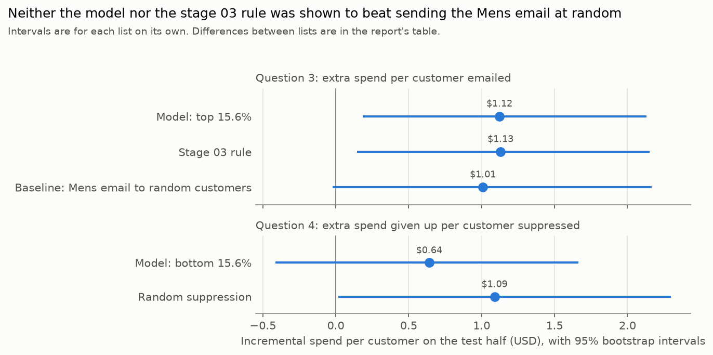

# Can a Model Target Better Than a Simple Rule?

## Question

Stage 03 built a targeting rule from two customer features, past-year spend and past purchases, and it was not shown to beat sending the Mens email to a random 10,000 customers. **This stage asks whether a model that uses all seven pre-campaign features can do better.** It informs challenge questions 3 and 4, but is not one of the original questions.

## Approach

Choices 1 to 7 below were **fixed before any model was fitted, but after the stage 03 results on the same test half had been seen** (see Limitations). The reasons are summarized here; the dated discussion is in [`DECISIONS.md`](../DECISIONS.md) (2026-11-16), and the code is in [`notebooks/04_01_uplift_models.ipynb`](../notebooks/04_01_uplift_models.ipynb).

1. **Same customers as stage 03:** the same 50:50 split, the same random 10,000 baseline and the same measure, rebuilt by [`src/prepare.py`](../src/prepare.py). A check confirms that the stage 03 numbers are reproduced exactly.
2. **Two estimates per customer:** each model estimates the extra outcome from the Mens email and from the Womens email, and each customer is assigned the email with the higher estimate, as in stage 03.
3. **Two models**, one simple and one flexible, so that a negative result cannot be blamed on choosing only one kind:
   - **Linear interaction model:** one regression of the target on both emails, all features and every email-by-feature interaction. It extends the stage 02 method.
   - **T-learner:** one gradient boosting model per email group. A customer's estimated effect is the email group model's prediction minus the No E-Mail model's prediction. Its settings are fixed in advance and not tuned.
4. **Three training targets, one score:** each model is trained on `spend`, `visit` or `conversion`, which gives six combinations. **Every combination is judged only by the extra spend of the customers it selects,** because the plan makes spend the primary metric. Visits are far more common than purchases (about 15% against 0.9%), so a model trained on them may rank customers better even when spend is the goal.
5. **One test, not six:** the six combinations are compared only within the training half, by 5-fold cross-validation. Only the highest-scoring one is evaluated on the test half. Testing all six there and reporting the best would inflate the result, as the top cell did in stage 03.
6. **Ranking within the test half:** a model's predictions for customers it was trained on are more extreme than for new customers. Ranking all 64,000 together would let training customers crowd the top of the list. **The model therefore selects the top 15.6% of the test half** (10,000 ÷ 64,000), about 5,000 customers, and suppresses the bottom 15.6% for question 4.
7. **Same threshold as stage 03:** the model replaces the Mens email baseline only if the 95% bootstrap interval for model minus baseline lies entirely above zero. The suppression list is judged the same way against random suppression. The bootstrap resamples the test half 10,000 times with seed 42.
8. **Robustness check (added on November 22, 2026, after the results):** as in [stage 03](03_01_targeting_rule.md), random selection is also measured by the average across the whole test half. **This does not replace the threshold.**

## Answer

**Not shown. Neither of the model's lists passed the threshold against random selection, so the simple choice is kept.**

**To choose whom to email (question 3), the model was not shown to beat random selection.** Its selected customers gained $1.12 each on the test half, against $1.01 for the baseline. **The difference, $0.11, has a 95% interval from -$1.15 to $1.32.** This comparison is limited by sample size: the test half could reliably detect only a difference of about $1.76 per customer.

**The model and the stage 03 rule have almost the same estimate, but they are not shown to be equivalent.** The two gained $1.12 and $1.13. The lists share most of their customers, so this comparison is more precise than the one with the baseline, but it is still limited by sample size. **The interval for their difference, -$0.53 to $0.52, still allows a difference of about $0.50 in either direction, roughly two-thirds of the Mens email's average effect.** Using all seven features, the model's top 15.6% included every test customer who had bought both men's and women's merchandise, the cell the stage 03 rule had already ranked first.

**To choose whom to suppress (question 4), the model was not shown to beat random selection either.** Suppressing its bottom 15.6% gave up $0.64 per customer, against $1.09 for random suppression. The difference, $0.45, has an interval from -$0.91 to $1.90, and the test half could reliably detect only a difference of about $2.00. **The gap also disappears when random selection is measured by the test-half average** ([see below](#does-the-result-depend-on-the-random-draw)).

## Results on the test half

| List | Test customers | Incremental spend per customer (95% CI) |
| --- | ---: | --- |
| Model: top 15.6% | 5,000 | +$1.12 ($0.18 to $2.13) |
| Baseline: Mens email to a random 10,000 | 4,920 | +$1.01 (-$0.02 to $2.17) |
| Stage 03 rule | 5,017 | +$1.13 ($0.15 to $2.15) |
| **Model minus baseline** | | **+$0.11 (-$1.15 to $1.32)** |
| Model minus stage 03 rule | | -$0.01 (-$0.53 to $0.52) |
| Suppressed by the model (spend given up) | 5,000 | +$0.64 (-$0.41 to $1.66) |
| Suppressed at random (spend given up) | 4,920 | +$1.09 ($0.02 to $2.30) |
| **Random minus model's suppression** | | **+$0.45 (-$0.91 to $1.90)** |

The interval for model minus stage 03 rule is much narrower than the others, because the two lists share 3,234 customers and much of their noise cancels out.

The figure shows each list's own interval. Judgments rest on the intervals for differences in the table above, which can be much narrower when two lists overlap.

| Comparison | Standard error | Smallest difference reliably detectable |
| --- | ---: | ---: |
| Model minus baseline | $0.63 | $1.76 |
| Model minus stage 03 rule | $0.27 | $0.75 |
| Random minus model's suppression | $0.72 | $2.00 |

The smallest reliably detectable difference is 2.8 times the bootstrap standard error: a true difference that large would give an interval above zero about 80% of the time.

## Does the result depend on the random draw?

**The size of each gap does; the decision does not.** This is the same check as in stage 03.

| How random selection is measured | Question 3: model's gain over random | Question 4: model's saving over random |
| --- | --- | --- |
| **One random draw (threshold)** | **+$0.11 (-$1.15 to $1.32)** | **+$0.45 (-$0.91 to $1.90)** |
| Test-half average (check) | +$0.51 (-$0.36 to $1.44) | -$0.01 (-$0.93 to $0.94) |
| Test-half average, Mens email for everyone (check) | As above | -$0.30 (-$1.34 to $0.70) |

Question 4's first two rows use the emails the model would send. The last row suppresses from the recommended campaign, the Mens email for everyone.

**Against the average, the send list looks better and the suppression list shows no saving.** Half of 5,000 random lists of the same size gave up no more than the model's suppression list. **Every interval in the table includes zero, so neither list is shown to be better under either measure.**

## How the model was chosen

| Model | Training target | Mean cross-validation score | Range across folds |
| --- | --- | ---: | --- |
| **Linear** | **visit** | **$1.95** | -$0.24 to $5.00 |
| Linear | conversion | $1.07 | -$0.38 to $2.88 |
| Linear | spend | $0.92 | -$0.01 to $2.13 |
| T-learner | visit | $0.46 | -$0.98 to $2.09 |
| T-learner | conversion | $0.44 | $0.04 to $1.15 |
| T-learner | spend | -$0.37 | -$1.34 to $0.26 |
| *Reference: random 15.6%, Mens email* | | *$1.15* | *-$1.27 to $3.62* |

Scores are the incremental spend per selected customer within each held-out fold of the training half.

- **Both models scored higher when trained on visits or conversion than on spend,** as expected from how rare purchases are.
- **The T-learner trained on spend scored below zero, the worst of the six.** A likely explanation, not tested here, is that each of its group models learned from only about 80 buyers per fold, some of whom spent several hundred dollars, and fitted a few large purchases that did not recur. The linear model cannot bend to fit single buyers, which may have made it steadier with this little data.
- **The scores are very noisy,** because each fold selects only about 1,000 customers. The ranking of the six is therefore a best bet. The winner's score fell from $1.95 in cross-validation to $1.12 on the test half, consistent with picking the highest of six noisy scores.

## Whom the model selected

| Stage 03 cell | Customers in the model's list | Share of the cell in the test half |
| --- | ---: | ---: |
| $200 or more, both | 3,217 | 100% |
| Under $100, men's only | 632 | 11% |
| $200 or more, men's only | 457 | 9% |
| Under $100, women's only | 413 | 7% |
| $100-$200, women's only | 131 | 4% |
| $100-$200, men's only | 110 | 3% |
| $200 or more, women's only | 40 | 1% |

**Almost two-thirds of the model's list is one cell, the one the stage 03 rule ranked first.** The model assigned the Womens email to 584 of its 5,000 customers.

## Visits and conversion

| List | Extra visits (percentage points) | Extra conversion (percentage points) |
| --- | ---: | ---: |
| Model: top 15.6% | 11.0 | 1.2 |
| Baseline | 9.9 | 0.7 |
| Stage 03 rule | 10.6 | 1.2 |
| Suppressed by the model | 7.8 | 0.6 |
| Suppressed at random | 9.4 | 0.6 |

**These are descriptive only.** The lists to email gained more visits than the baseline. The model was trained on visits, so this is expected for its list and is not evidence that it targets spend better. The model's suppression list gave up fewer visits than the random draw, but slightly more than the test-half average (7.8 against 7.5 points), so **visits show no saving from suppressing it either.**

## What this means

- **For questions 3 and 4: choose at random.** Neither a two-feature rule nor a seven-feature model was shown to select better customers, to email or to suppress, than random selection. Send the Mens email as widely as the budget allows, and when the number is limited, draw the customers at random. **The case for sending rests on the average effect across all customers** ($0.77, 95% CI $0.49 to $1.05, against a $0.02 break-even), not on evidence that it pays in every cell.
- **For the business:** building and maintaining a targeting model would add cost without a demonstrated gain on this data.
- **For stage 06:** the profit and sensitivity analysis uses the Mens email sent broadly as the main case.
- **For a new experiment:** compare the model with random selection directly, in three randomly assigned groups: no email, the Mens email to a random share, and the same share chosen by the model, as in the [decision memo](decision_memo.md#next-step). Size it from the smallest gain that would matter to the business, not from the gaps observed here. The first version of this report sized one at about 71,000 customers per list from the $0.45 saving. **That figure should not be used, because the saving depends on the random draw.**

## Limitations

- **Only two models were tried, with fixed settings.** Tuning or other methods might do better, but tuning on about 290 training buyers would itself risk fitting noise.
- **The test half is small for comparisons with the baseline.** About 5,000 customers fall in each list, and only about a third of them received no email. A real gain smaller than about $1.76 per customer would likely go undetected. The comparison with the stage 03 rule is more precise, but it too could reliably detect only a difference of about $0.75.
- **The test half was not untouched.** Its stage 03 results, including the effect in each cell, had been seen before this stage was designed, and they may have influenced the design. No stage 04 model was trained or selected on the test half, but **its result is not a fully independent confirmation**. That would need new data.
- **The choice among the six combinations is uncertain.** Their cross-validation scores overlap heavily, so a different split could have chosen a different winner.
- **The threshold uses one random draw.** The check against the test-half average was added after the results, so it describes robustness and is not a second chance to pass.
- **Outcomes cover two weeks, and the data is from 2008,** as in stage 03.
