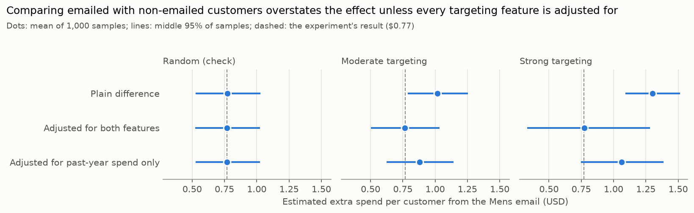

# How Wrong Would the Estimate Be Without Random Assignment?

## The question

In this experiment, a random draw decided which customers received an email. The emailed and non-emailed groups were therefore alike before the campaign, and the difference in their spending measures the email's effect: **the Mens email added $0.77 per customer over two weeks** ([stage 01](01_01_average_effects.md)).

Most companies do not randomize. They email the customers who look most likely to buy. **This report asks how far a simple comparison of emailed and non-emailed customers would then drift from $0.77, and whether adjusting for customer features brings it back.** It answers none of the challenge questions. It shows why the rest of this project relies on the experiment.

## Short answer

- **Comparing emailed with non-emailed customers overstated the effect by 32% when targeting was moderate, and by 69% when it was strong:** $1.02 and $1.30 instead of $0.77.
- **Adjusting for both features used to choose customers removed the bias,** but the estimates varied much more from sample to sample.
- **Adjusting for only one of the two features removed about half of the bias:** 14% and 38% remained.
- **The lesson: adjustment works only if every reason behind who got the email was recorded, and an analyst cannot check that. Random assignment does not need it.**

## How the targeted data were made

The idea is to start from the experiment, where random assignment provides a benchmark, and drop customers until the remaining data look as if a company had chosen whom to email.

1. **Who looks likely to buy.** Each customer gets one point for a purchase in the last 3 months and one point for $200 or more of past-year spend. Of the 42,613 customers in the Mens E-Mail and No E-Mail groups, 17,797 (42%) score 0, 16,975 (40%) score 1, and 7,841 (18%) score 2.
2. **How strongly the company targets.** Three scenarios set the share of customers who get the email at each score:

   | Scenario | Score 0 | Score 1 | Score 2 |
   | --- | ---: | ---: | ---: |
   | Random (a check) | 50% | 50% | 50% |
   | Moderate targeting | 30% | 50% | 70% |
   | Strong targeting | 10% | 50% | 90% |

3. **Dropping customers to match a scenario.** In the experiment, about half of each score received the email. To make 90% of score-2 customers emailed, keep every emailed customer with a score of 2 and about 1 in 9 of the non-emailed ones. For score 0, do the reverse. In general, an emailed customer is kept with probability e ÷ 0.9, and a non-emailed one with (1 − e) ÷ 0.9, where e is the scenario's share for that score. This method is called RCT rejection sampling ([Keith et al., 2023](https://arxiv.org/abs/2307.15176)).
4. **Why $0.77 is still the benchmark.** Every score keeps the same share of its customers, about 56%, so the kept customers have the same mix of scores as everyone. Within a score, who got the email was still decided by the experiment's random draw. **Only the link between score and email has changed, which is what targeting does.** The notebook checks that each score's share emailed matches its target.
5. **Repeating it.** Each scenario is drawn 1,000 times with different random drops, keeping about 23,700 customers each time, so that results reflect the method and not one lucky draw.

## Three ways to estimate the effect

| Estimate | How it works | What it needs to be right |
| --- | --- | --- |
| **Plain difference** | Mean spend of emailed customers minus mean spend of the others | Emailed and non-emailed customers alike apart from the email |
| **Adjusted for both features** | Compare within each of the four combinations of recent purchase and $200 or more, then average, weighting each by its number of customers | Every feature used to choose customers recorded and adjusted for |
| **Adjusted for past-year spend only** | The same, within the two spend groups only, as if recency had not been recorded | Past-year spend to be the only feature used, which it is not |

A weighting method, inverse probability weighting, gives the same answer as the second estimate here, because both features are yes-or-no.

## Results

The average of 1,000 samples per scenario, with the bias as a share of $0.77, and the range that holds the middle 95% of samples.

| Scenario | Plain difference | Adjusted for both features | Adjusted for past-year spend only |
| --- | --- | --- | --- |
| Random (check) | $0.77 (0%), $0.53 to $1.03 | $0.77 (0%), $0.53 to $1.03 | $0.77 (0%), $0.53 to $1.03 |
| Moderate targeting | **$1.02 (+32%)**, $0.79 to $1.25 | $0.77 (−1%), $0.50 to $1.03 | **$0.88 (+14%)**, $0.62 to $1.14 |
| Strong targeting | **$1.30 (+69%)**, $1.09 to $1.52 | $0.77 (+1%), $0.33 to $1.28 | **$1.06 (+38%)**, $0.75 to $1.39 |

Bias counts as removed when the average is within 10% of $0.77, a threshold chosen in advance as a judgment call. **It is removed in every random scenario and by adjusting for both features, and in no other case.** With 1,000 samples, each average has a Monte Carlo standard error below $0.01, so the averages are precise.

## Why the plain difference goes wrong

*This section was added after the results were seen, to explain them. It changes neither the design nor any verdict.*

**Customers who look likely to buy spend more even without an email.** These figures use all 42,613 customers:

| Score | Spend without email | Spend with the Mens email | Estimated effect |
| ---: | ---: | ---: | ---: |
| 0 | $0.41 | $0.89 | $0.48 |
| 1 | $0.65 | $1.53 | $0.89 |
| 2 | **$1.21** | $2.38 | $1.16 |

**Under strong targeting, the two groups being compared are made of different customers.** 41% of emailed customers have a score of 2, against 3% of non-emailed ones, and 10% of emailed customers have a score of 0, against 63% of non-emailed ones.

**The plain difference therefore adds two things to the email's effect:**

| | Moderate targeting | Strong targeting |
| --- | ---: | ---: |
| The email's effect, averaged over all customers | $0.77 | $0.77 |
| + emailed customers spend more even without an email | +$0.17 | +$0.34 |
| + emailed customers are mostly those with larger estimated effects | +$0.09 | +$0.19 |
| = expected plain difference | $1.02 | $1.30 |

The first addition is the main one: **the email gets credit for spending that the targeted customers would have done anyway.** The second arises because the plain difference measures the effect on the customers who were emailed, not on all customers. The larger effects at higher scores are estimates; [stage 02](02_01_segment_effects.md) could not show that effects really differ across segments.

## What each estimate shows

1. **The random scenario is a check.** All three estimates average $0.77, which confirms that dropping customers this way does not by itself create bias.
2. **The plain difference always overstates the effect, and more data would not fix it.** Under strong targeting, the middle 95% of its samples runs from $1.09 to $1.52 and does not include $0.77. **It is precise but wrong.**
3. **Adjusting for both features removes the bias, at a cost in precision.** Comparing customers only with similar customers makes the comparison fair. But under strong targeting, a sample keeps only about 430 non-emailed customers with a score of 2 and about 990 emailed customers with a score of 0, so these comparisons are noisy, and the middle 95% widens to $0.33 to $1.28. **The less often a company leaves its best customers out, the less it can learn from them.**
4. **Leaving out one feature leaves bias behind.** Within each spend group, emailed customers are still more often recent buyers, who spend more anyway. A real company may also choose customers using information that was never recorded, such as a salesperson's judgment, and the analyst cannot tell what is missing.

## What this means for the project

- **The answers to the challenge questions rely on random assignment.** The plain comparisons in stage 01 are valid because the groups were balanced before the campaign ([experiment validity](00_02_experiment_validity.md)).
- **A company that wants to measure its campaigns needs a randomized comparison group,** for example a random set of customers left out of each campaign. Adjusting afterwards is only as good as the record of how customers were chosen.

## Design choices

The design was **[committed](https://github.com/flora29058486/email-campaign-targeting/commit/860af22) before the notebook was run**, and the dated entry is in [`DECISIONS.md`](../DECISIONS.md) (2026-11-25). The code is in [`notebooks/05_01_bias_demonstration.ipynb`](../notebooks/05_01_bias_demonstration.ipynb). The score, the three scenarios, the 10% threshold and the 1,000 samples are judgment calls, not taken from the method's source. Only two features drive the targeting, so that adjusting for both of them is possible: this makes the second estimate a best case.

## Limitations

- **A demonstration of a known mechanism, not a finding.** Stage 02 had already shown that recent customers spend more even without an email, so the direction of the bias was expected.
- **Real targeting is messier.** Companies use many features, model scores and judgment, so the size of the bias here applies only to this construction.
- **A best case for adjustment.** The targeting depended only on two recorded yes-or-no features, so comparing within four groups matched it exactly. In practice, adjustment also needs a correct model of how customers were chosen.
- **Smaller samples than the experiment.** Each sample keeps about 56% of customers, so the ranges are wider than the intervals in stage 01.
- **As in earlier stages:** effects are of assignment rather than reading, outcomes cover two weeks, the data is from 2008, and spend may be capped at $499.
