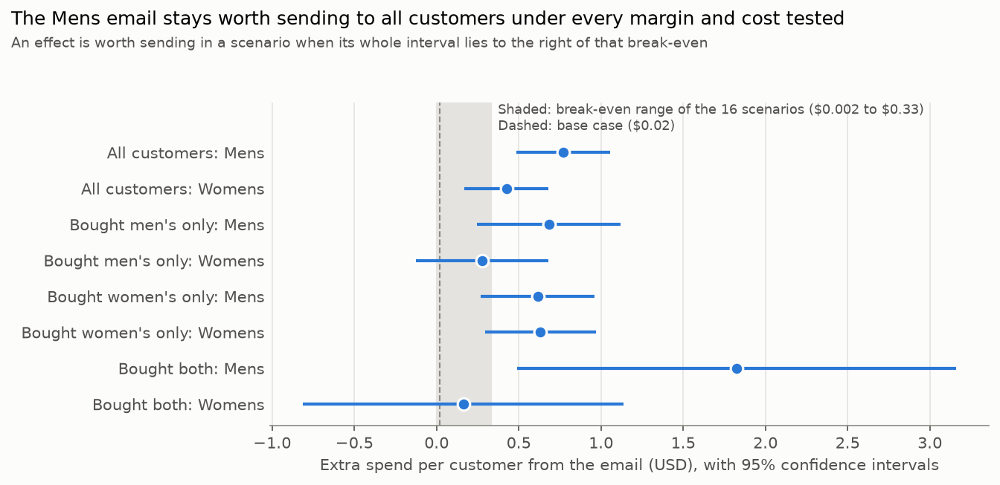

# Questions 3, 4 and 8: Do the Answers Hold Under Other Costs?

## Questions

3. **If you could only send an e-mail campaign to the best 10,000 customers, which customers would receive the e-mail campaign? Why?**
4. **If you had to eliminate 10,000 customers from receiving an e-mail campaign, which customers would you suppress from the campaign? Why?**
8. **Which audience would you target the Mens version to, and the Womens version to, given the results of the test? What data do you have to support your recommendation?**

These are quoted from the original challenge. Stages 02 to 04 answered them under one assumption about margin and cost per email. This report tests the answers under the other values in the analysis plan.

## Approach

The design was **[committed](https://github.com/flora29058486/email-campaign-targeting/commit/ab19efd) before the notebook was run**. The dated entry is in [`DECISIONS.md`](../DECISIONS.md) (2026-11-24), and the code is in [`notebooks/06_01_profit_sensitivity.ipynb`](../notebooks/06_01_profit_sensitivity.ipynb).

- **Two assumptions:** the data contains no margin or cost per email. The [analysis plan](../analysis_plan.md) sets a base case of a 40% gross margin and $0.008 per email, and tests margins of 30%, 40%, 50% and 60% and costs of $0.001, $0.008, $0.05 and $0.10.
- **Only one ratio matters:** an email pays when margin × incremental spend exceeds its cost, so when incremental spend exceeds the **break-even, cost ÷ margin**. **The 16 combinations therefore give 15 different break-even values, from $0.002 to $0.333 per customer,** and each effect is placed on this one scale.
- **No new estimates:** the eight effects come from earlier stages, recomputed with the same methods on all 64,000 customers. They are the Mens and Womens emails against no email, for all customers ([stage 01](01_01_average_effects.md), Welch) and for the three past-purchase audiences ([stage 02](02_02_email_by_segment.md), HC3).
- **Categories:** as fixed on 2026-11-06, an effect is **worth sending** if the lower end of its 95% interval is above break-even, **uncertain** if only the estimate is, and **not worth sending** otherwise. The base case (break-even $0.02) gives the answers.
- **Revenue-first scenario:** the plan also reports, separately, a scenario that accepts a loss of up to 5% of incremental spend. Its break-even is cost ÷ (margin + 0.05), the same as a margin 5 points higher.
- **What this cannot change:** whom to choose and which email to send. Lists of the same size cost the same, and both emails cost the same, so costs cancel when they are compared and the margin only scales the difference.
- **Not a blind test:** every input had already been reported, so most results follow from known numbers by arithmetic. Fixing the rule first prevents choosing the wording after seeing the tables.

## Answers

**No answer changes. The Mens email pays under every margin and cost tested, so the answers to questions 3, 4 and 8 are final.**

**Question 3: send the Mens email to 10,000 customers drawn at random.** At the base case, this earns about **$3,000 in profit over two weeks** (95% CI $1,861 to $4,138). Across the 16 combinations, the estimate ranges from $1,309 to $4,609, and the lower end of the interval never falls below $455. Why the customers are drawn at random is explained in [stage 03](03_01_targeting_rule.md): no list was shown to choose better.

**Question 4: avoid suppressing. If 10,000 customers must be suppressed, choose them at random.** Suppressing a random 10,000 from the Mens email gives up the same profit: about $3,000 at the base case. **Its interval stays above zero in all 16 combinations, so suppression gives up profit under every assumption tested.**

**Question 8: send the Mens email to all three past-purchase audiences by default. If the Womens email must be used, send it only to customers who bought only women's merchandise.** The Mens email is worth sending to each audience in at least 14 of the 16 combinations. **It becomes uncertain only at $0.10 per email with a low margin, and it is never "not worth sending".** The Womens email is worth sending to women's-only buyers in 15 of the 16 combinations, and never to the other two audiences.

**For a manager: the Mens email stays worth sending while each email costs less than about $0.15 at a 30% margin, or $0.29 at a 60% margin.** That is at least 18 times the assumed $0.008.

## Each effect in the 16 combinations

| Effect | Estimate (95% CI) | Base case | Worth sending | Uncertain | Not worth sending |
| --- | --- | --- | ---: | ---: | ---: |
| All customers: Mens | +$0.77 ($0.49 to $1.05) | Worth sending | 16 | 0 | 0 |
| All customers: Womens | +$0.42 ($0.17 to $0.68) | Worth sending | 13 | 3 | 0 |
| Bought men's only: Mens | +$0.68 ($0.25 to $1.12) | Worth sending | 14 | 2 | 0 |
| Bought men's only: Womens | +$0.28 (-$0.12 to $0.68) | Uncertain | 0 | 15 | 1 |
| Bought women's only: Mens | +$0.62 ($0.27 to $0.96) | Worth sending | 15 | 1 | 0 |
| Bought women's only: Womens | +$0.63 ($0.30 to $0.97) | Worth sending | 15 | 1 | 0 |
| Bought both: Mens | +$1.82 ($0.49 to $3.16) | Worth sending | 16 | 0 | 0 |
| Bought both: Womens | +$0.16 (-$0.81 to $1.14) | Uncertain | 0 | 11 | 5 |

- **Uncertain only at $0.10 per email:** the Womens email for all customers (30% to 50% margin), the Mens email for men's-only buyers (30% and 40%), and both emails for women's-only buyers (30%).
- **Never worth sending:** the Womens email for buyers of men's only, which is not worth sending at 30% and $0.10, and for buyers of both lines, which is not worth sending in the five combinations with a break-even above $0.16.
- **Revenue-first scenario: two labels change, both to worth sending.** They are the Mens email for men's-only buyers at 40% and $0.10, and the Womens email for women's-only buyers at 30% and $0.10. No answer changes.

## Profit from a random 10,000 (questions 3 and 4)

Estimated profit over two weeks, 10,000 × (margin × $0.77 − cost per email). The base case is in bold.

| Cost per email | 30% margin | 40% margin | 50% margin | 60% margin |
| --- | ---: | ---: | ---: | ---: |
| $0.001 | $2,299 | $3,069 | $3,839 | $4,609 |
| $0.008 | $2,229 | **$2,999** | $3,769 | $4,539 |
| $0.05 | $1,809 | $2,579 | $3,349 | $4,119 |
| $0.10 | $1,309 | $2,079 | $2,849 | $3,619 |

**Every estimate is positive, and so is the lower end of every interval** (lowest $455, at 30% and $0.10). Sales are the same in every combination, $7,698 (95% CI $4,851 to $10,545), because neither margin nor cost changes how much customers spend.

## The highest cost per email that still pays

| Margin | Worth sending while cost per email is below | Estimate covers the cost while it is below |
| --- | ---: | ---: |
| 30% | $0.146 | $0.231 |
| 40% | $0.194 | $0.308 |
| 50% | $0.243 | $0.385 |
| 60% | $0.291 | $0.462 |

The first column is margin × the lower end of the Mens email's interval ($0.49), and the second is margin × its estimate ($0.77). **Above the first, the Mens email would become uncertain; above the second, not worth sending.**

The shaded band is the break-even range of the 16 combinations. **The two intervals that reach below zero, the Womens email for buyers of men's only and of both lines, are uncertain even at the base case.** The others become uncertain only where their lower end falls inside the band.

## Limitations

- **Assumptions, not measurements:** the margin and cost per email come from recent public figures, while the experiment is from 2008, and the retailer's actual margin is unknown.
- **Costs that are not included:** unsubscribes, email fatigue, creative and staff costs, and customer value beyond two weeks, as stated in the plan. They could make sending worth more or less than shown.
- **Intervals are not corrected for the eight effects:** corrected intervals would be wider, so more labels would become uncertain at the higher break-evens. At the base case, the labels used for question 8 held with corrected intervals in the [stage 02 check](02_02_email_by_segment.md).
- **Expected values for a random 10,000:** any one random draw will differ. In [stage 03](03_01_targeting_rule.md), the draw used as a baseline responded more than average.
- **As in earlier stages:** effects are of assignment rather than reading, outcomes cover two weeks, and spend may be capped at $499.
