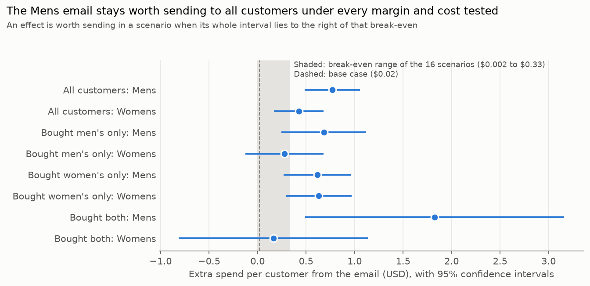
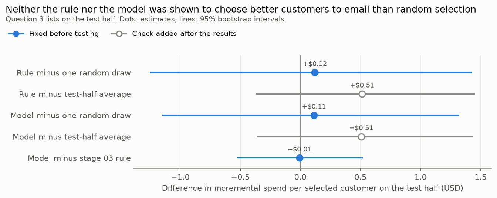
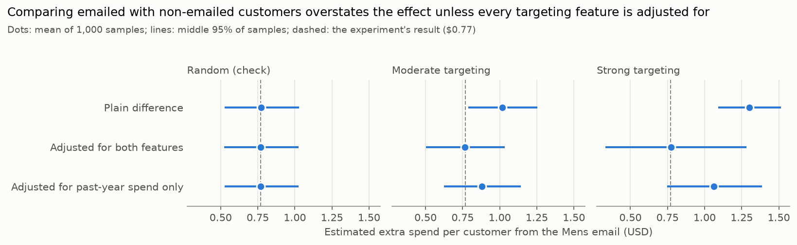

# Email Campaign Targeting with Experimental Data: Technical Report

*November 2026. Each section summarizes stage reports that hold the full analysis, linked in the text. The eight challenge questions are answered one by one in [challenge_answers.md](challenge_answers.md).*

## 1. Abstract

A retailer randomly assigned 64,000 customers to receive an email featuring men's merchandise, an email featuring women's merchandise, or no email, and recorded what they spent over the next two weeks (Hillstrom, 2008). This project uses that experiment to ask three questions in turn: did the emails raise spend, can the customers who respond more be identified in advance, and what should a marketing team do when the answers are uncertain? **The Mens email raised spend by $0.77 per customer (95% CI $0.49 to $1.05), far above the $0.02 needed to cover its cost under the base-case assumptions.** No segment was shown to respond more. Neither a two-feature targeting rule nor an uplift model using all seven features was shown to choose better customers than random selection on held-out data. **The recommendation is therefore the simple one: send the Mens email as widely as the budget allows, and choose customers at random when the number is limited.** At a 40% margin and $0.008 per email, emailing a random 10,000 customers earns about $3,000 over two weeks, and the conclusion holds under every margin and cost tested. A simulation built from the same data shows why the experiment matters: when sending was targeted, a simple comparison of emailed and non-emailed customers overstated the effect by up to 69%.

## 2. Research question and experimental design

**The project asks three questions, each depending on the one before:**

1. **Causal effect:** did each email raise spend, and by how much? (challenge questions 1, 2 and 6)
2. **Heterogeneous effects:** did some customers respond more, or to a different email? (questions 5, 6 and 8)
3. **Decision under uncertainty:** whom should a team email or leave out, and does sending pay, when the estimates are noisy? (questions 3, 4 and 8)

Question 7, on anomalies, is answered during data preparation.

**Data.** All 64,000 customers had purchased in the past twelve months and were assigned at random to three groups of about 21,300. Eight pre-campaign features describe them, such as months since last purchase, past-year spend and which merchandise lines they had bought. Visits, purchases and spend were recorded for two weeks. **Spend is extremely sparse: 99.1% of customers spent nothing, so every spend estimate rests on 578 buyers.**

**Checks found no evidence of a problem with the random assignment** ([experiment validity](00_02_experiment_validity.md)). Group sizes match the intended split (chi-square p = 0.904), and the largest standardized mean difference across 54 comparisons of pre-campaign features is 0.0169, against a common threshold of 0.1. The data records assignment, not delivery or opening, so every effect is the effect of being assigned an email. 6,562 exactly repeated rows are kept, because without a customer ID they cannot be told apart from different customers. Spend stops at exactly $499 for 12 buyers, which may indicate a cap ([EDA summary](00_01_eda_summary.md)).

## 3. Analytical framework

**Every test, threshold and decision rule was written down before the outcomes it judged were viewed, and checks added later are labeled as such.**

- **Analysis plan** ([committed](../analysis_plan.md) on November 2, 2026, before any outcome was compared across groups). Spend is the primary metric, and visits and conversion only check consistency. Groups are compared by Welch t-tests with a bootstrap check, six segment hypotheses are tested as OLS interactions with robust (HC3) standard errors, and each family of tests is Holm-corrected.
- **Decision rule.** The data contains no margins or costs, so both are stated assumptions: a base case of a 40% gross margin and $0.008 per email, tested from 30% to 60% and from $0.001 to $0.10. An email pays when margin × incremental spend exceeds its cost, so **incremental spend must exceed break-even, cost ÷ margin, which is $0.02 per customer in the base case.** There are three labels:
  - **Worth sending:** the lower end of the 95% interval is above break-even.
  - **Uncertain:** only the estimate is above break-even.
  - **Not worth sending:** neither is.
- **Held-out evaluation for targeting.**
  - The data is split 50:50, stratified by group (seed 42), and rules and models are built on the training half only.
  - **A list replaces the simple choice, the Mens email sent to an actual random 10,000 customers, only if the 95% bootstrap interval for its advantage on the test half lies entirely above zero.**
- **"Not shown" is not "equal".** When an interval includes zero, the reports give the smallest difference the data could reliably detect, 2.8 bootstrap standard errors (about 80% power).

| When the choice was made | What was fixed | Where it is recorded |
| --- | --- | --- |
| Before any outcome was compared across groups (November 2) | Metrics, tests, the six segment hypotheses, the Holm families, the margin and cost grid | [`analysis_plan.md`](../analysis_plan.md) |
| Before each stage was run (November 6 to 25) | The three labels; the stage 03 cells, split and threshold; the stage 04 models and how one was chosen; criteria for questions 5 and 8 (exploratory, because segment results had been seen); the stage 05 and 06 designs | [`DECISIONS.md`](../DECISIONS.md) and the design commits in section 7 |
| After the results, labeled in each report | Regression adjustment of the average effects; random selection measured by the test-half average; corrected intervals and a fragility check for question 8; the explanation of the bias in stage 05; Figure 2 | The stage reports |

## 4. Results and policy evaluation

### 4.1 Both emails raised spend, the Mens email more

**The Mens email added $0.77 per customer over two weeks (95% CI $0.49 to $1.05), and the Womens email $0.42 ($0.17 to $0.68)** ([stage 01](01_01_average_effects.md)). Customers with no email spent $0.65 on average.

- **Mens against Womens:** the Mens email's lead, $0.35 ($0.03 to $0.66, Holm p = 0.031), is significant but imprecisely estimated.
- **Robustness:** bootstrap intervals and a regression adjustment for all pre-campaign features each changed the results by less than $0.01.
- **Secondary metrics:** visits (+7.66 percentage points for the Mens email) and conversion (+0.68 points) point the same way.

**At the base case, both emails are worth sending to customers in general** (Figure 1, top two rows).

*Figure 1. Each email's effect on spend for all customers and for the three past-purchase audiences, with 95% confidence intervals. Dashed line: base-case break-even ($0.02). Shaded band: break-even range across the 16 margin and cost combinations. From [stage 06](06_01_profit_sensitivity.md).*

### 4.2 No segment was shown to respond more

**None of the six pre-specified segment hypotheses was supported** ([stage 02](02_01_segment_effects.md)).
- **What was tested:** whether the effect on spend was larger in one segment than another. The segments were recent buyers, matching past purchases (two tests), web and multichannel buyers, higher past spend, and urban zip codes.
- **What was found:** all six differences were positive, but every interval included zero, and the smallest Holm-adjusted p-value was 0.67.
- **What this does not mean:** that the effects are equal. A difference between two effects is estimated far less precisely than either effect, and most intervals were about $1 wide.

**A direct comparison of the two emails, exploratory but with criteria committed before it was run, answers question 8** ([email by segment](02_02_email_by_segment.md)):

| Past purchases | Mens email (95% CI) | Womens email (95% CI) | Mens minus Womens (95% CI) |
| --- | --- | --- | --- |
| Men's only | **+$0.68 ($0.25 to $1.12)** | +$0.28 (-$0.12 to $0.68) | +$0.40 (-$0.07 to $0.88) |
| Women's only | **+$0.62 ($0.27 to $0.96)** | **+$0.63 ($0.30 to $0.97)** | -$0.02 (-$0.42 to $0.39) |
| Both lines | **+$1.82 ($0.49 to $3.16)** | +$0.16 (-$0.81 to $1.14) | +$1.66 ($0.33 to $2.99) |

*Bold: worth sending at the base case.*

- **Mens email:** worth sending to all three audiences.
- **Womens email:** worth sending only to women's-only buyers, where neither email was shown better.
- **Buyers of both lines:** the Mens email's lead (Holm p = 0.043) is fragile. It rests on 53 and 31 buyers, and without the single largest purchase the Holm p-value rises to about 0.075.
- **Question 5:** across six segment splits, the Mens email's lead never differed significantly.

### 4.3 Neither a rule nor a model was shown to beat random selection

Questions 3 and 4 ask which 10,000 customers to email and which to leave out. Two approaches were built on the training half:

- **Rule** ([stage 03](03_01_targeting_rule.md)): seven cells cross past-year spend with past purchases, and are ranked by the higher of the two emails' training estimates. The top 10,000 are all 6,448 customers with $200 or more who bought both lines, plus 3,552 with $200 or more who bought only women's merchandise, all sent the Mens email.
- **Uplift model** ([stage 04](04_01_uplift_models.md)): of six candidates (a linear interaction regression and a gradient-boosted T-learner, each trained on spend, visits or conversion), cross-validation within the training half chose the linear model trained on visits. Only it was tested, on the top 15.6% of the test half (10,000 ÷ 64,000).

**On the test half, neither list passed the threshold** (Figure 2).
- **To email:** the rule's customers gained $0.12 more per customer than a random 10,000 (95% CI -$1.25 to $1.43), and the model's $0.11 more (-$1.15 to $1.32).
- **To suppress:** random suppression gave up $0.56 more per customer than the rule's list (-$1.03 to $2.27) and $0.45 more than the model's (-$0.91 to $1.90).

*Figure 2. Each list's advantage in incremental spend per selected customer on the test half, with 95% bootstrap intervals. Filled markers were fixed before testing. Hollow markers measure random selection by the test-half average instead of the one random draw, a check added after the results. Made in the [stage 04 notebook](../notebooks/04_01_uplift_models.ipynb) from estimates reported in stages 03 and 04.*

**The size of each gap depends on how random selection is measured, but the decision does not.**
- **The draw:** the one random draw used as the baseline happened to respond more than average.
- **Against the test-half average:** both send lists gain $0.51, and the suppression lists save $0.22 and -$0.01.
- **Either way:** every interval includes zero.

**The test half could detect only large differences:** about $1.76 per customer between the model and random selection, and $1.89 for the rule. Both are more than twice the Mens email's average effect. **The model and the rule were not shown to differ** (-$0.01, -$0.53 to $0.52). They share most customers: the model selected every test customer who had bought both lines, the cell the rule ranked first.

**The training estimates did not hold up, a sign of regression to the mean.**
- **The rule:** its top cell gained $2.27 per customer in training but $1.37 on the test half. The three cells ranked highest all fell, and the four ranked lowest all rose.
- **The model:** its cross-validation score fell from $1.95 to $1.12, consistent with picking the best of six noisy scores.

Without held-out data, either would have looked like a large gain.

### 4.4 Sending pays under every margin and cost tested

**Stage 06 reclassified the eight effects in Figure 1 at each of the 16 margin and cost combinations** ([profit and sensitivity](06_01_profit_sensitivity.md)). These give 15 break-even values, from $0.002 to $0.333 per customer. Costs cannot change whom to choose or which email to send, because lists of the same size and both emails cost the same.

- **The Mens email is worth sending to all customers in all 16 combinations, and to each audience in at least 14.** It is never "not worth sending".
- **The Womens email is worth sending to women's-only buyers in 15 combinations, and never to the other two audiences.**
- **Emailing a random 10,000 earns an estimated $2,999 over two weeks at the base case (95% CI $1,861 to $4,138).** This is 10,000 × (margin × $0.77 − cost per email). Across the 16 combinations, the estimate ranges from $1,309 to $4,609. Suppressing a random 10,000 gives up the same amount.
- **The Mens email stays worth sending while each email costs less than about $0.15 at a 30% margin, or $0.29 at a 60% margin.** That is at least 18 times the assumed $0.008.
- **The plan's revenue-first scenario changes no answer.** It accepts a loss of up to 5% of incremental spend.

**These intervals describe uncertainty in the average effect, not a forecast for one campaign.** Any one random 10,000 will differ, as the draw in stage 03 did.

## 5. Why randomization matters

**Most companies cannot measure an email this way, because they email the customers who look most likely to buy.** Stage 05 ([bias demonstration](05_01_bias_demonstration.md)) recreates that situation from the experiment by RCT rejection sampling (Keith et al., 2023):
- **The targeting:** customers are dropped at random so that the email goes mostly to those with a recent purchase, $200 or more of past-year spend, or both.
- **Why the benchmark still applies:** within each kind of customer, the email is still assigned at random, so the experiment's own estimate on these 42,613 customers, $0.77, remains the benchmark.
- **Repetition:** each scenario is drawn 1,000 times.

| Scenario | Plain difference | Adjusted for both targeting features | Adjusted for past-year spend only |
| --- | --- | --- | --- |
| Moderate targeting | $1.02 (+32%) | $0.77 (−1%) | $0.88 (+14%) |
| Strong targeting | $1.30 (+69%) | $0.77 (+1%) | $1.06 (+38%) |

*Mean of 1,000 samples, with the bias as a share of the $0.77 benchmark. A random scenario, as a check, gave $0.77 for all three estimates.*

*Figure 3. Each estimate's mean and middle 95% of samples, against the experiment's result. From [stage 05](05_01_bias_demonstration.md).*

**Comparing emailed with non-emailed customers overstated the effect by up to 69%, and more data would not fix it.** Under strong targeting, the middle 95% of samples ran from $1.09 to $1.52, which excludes $0.77.
- **Spending that would have happened anyway:** $0.34 of the extra $0.53.
- **Who was emailed:** the other $0.19 arises because emailed customers are mostly those with larger estimated effects, which stage 02 could not confirm.
- **Adjusting for both features** used to choose customers removed the bias, but widened the middle 95% to $0.33 to $1.28.
- **Leaving one feature out** left 38%.

**Adjustment works only if every reason a customer was chosen is recorded, which a real company rarely knows.** That is why this project relies on random assignment.

## 6. Discussion and limitations

### 6.1 What the evidence supports

- **Strong:** the Mens email raised spend on average, and sending pays under every assumption tested.
- **Not shown:** that any segment responds more, or that any list chooses customers better than random selection. Differences between lists smaller than about $1.76 to $1.89 per customer would likely go undetected.
- **Unknown:** long-term customer value, unsubscribes, email fatigue, and whether a 2008 result holds today.

**The decision rule keeps the simple policy unless a more complex one is shown to be better.**
- **The simple policy:** its expected gain is the Mens email's average effect, which is well estimated.
- **A targeting list:** its advantage rested on rankings that did not replicate, and a model adds cost to build and maintain.
- **What the rule cannot show:** that targeting is useless. It shows only that this data does not justify it.

### 6.2 Comparison with an earlier analysis

**The challenge winner, Radcliffe (2008), analyzed the same data with uplift models. The two analyses agree on the average effects and differ mainly in the standard a targeting list had to meet.**

- **Agreement on averages.** He found the Mens email better on spend, purchases and visits, with incremental spend of 77¢ and 42¢ per head (sections 3 and 6).
- **The same warning about noise.** Across ten random samples of the customers, his estimate of the Mens email's effect on spend ranged from +$1.54 to -$0.07. He wrote that this "is clearly going to make it extremely hard to have confidence in any targeting of the campaign, certainly at cell sizes around 10,000" (section 4).
- **A different standard for a list.** For question 3, he took the customers scoring highest on a three-point model (past-year spend over $160, over $350, and buying through multiple channels), then added customers scoring 2 who bought on the web, because that subgroup showed the highest uplift (sections 5.7 and 5.9). The 9,933 customers had an expected uplift of $1.58, estimated on the same data used to choose the subgroups. **This project instead required a list to beat a random list of the same size on held-out data, by a margin set in advance.** Stage 03 shows why: its top cell's estimate fell from $2.27 in training to $1.37 on held-out data.
- **Suppression.** For question 4, he also chose at random, but within a group: 10,000 drawn from 12,952 customers who scored lowest on both of his models, whose estimated effect from the Mens email was 5¢ (section 5.10). This project draws them from all customers, because no suppression list beat random selection on held-out data.

**Neither analysis shows the other to be wrong.**
- Both put customers with high past spend first.
- This project's tests could detect only large differences, so his ranking may reflect real differences that a held-out test of this size cannot confirm.
- The two ask different questions. His asks which customers have the highest estimated uplift. This project asks whether acting on such an estimate is shown to beat random selection.

### 6.3 Limitations

- **Two weeks, in 2008.** Long-term value, unsubscribes and fatigue are not measured, and behavior has changed since. Margin and cost are assumptions based on recent public figures, not the retailer's own.
- **Few buyers.** With 578 buyers, comparisons between segments and between lists could detect only large differences.
- **One test half, used twice.** Stage 04 was designed after the stage 03 results on the same test half had been seen, so it is not a fully independent confirmation. The threshold used one random draw, and the check against the test-half average was added afterwards.
- **Data anomalies.** If spend was capped at $499, the effects may be understated, because more of the 12 buyers at that amount were emailed.
- **A demonstration, not a finding.** In stage 05, targeting depended on two recorded features, a best case for adjustment.
- **A well-known public dataset.** This project does not claim new findings. Its focus is the decision framework and how it was tested.

### 6.4 Recommended next experiment

**Keep a random holdout in every campaign, and test targeting against random selection directly.** A follow-up experiment would randomly assign eligible customers to three arms:

1. No email (control).
2. The Mens email to a random share of the arm.
3. The same share, chosen by an uplift model, which also picks the email.

**Arms 2 and 3 use the same budget, so their difference in incremental profit per eligible customer measures the value of targeting.** Its sample size should come from the smallest gain that would justify building and maintaining a model, not from the differences observed here, which are within noise. This experiment has not been run.

## 7. Reproducibility

- **Code:**
  - one notebook per stage in [`notebooks/`](../notebooks), numbered as in the README's [analysis map](../README.md#analysis-map);
  - the shared split and random baseline in [`src/prepare.py`](../src/prepare.py);
  - the data downloaded by [`src/download_data.py`](../src/download_data.py).

  Every random step uses seed 42.
- **Decisions:** [`DECISIONS.md`](../DECISIONS.md) records each choice by date, with its reason and who proposed it. Designs committed before they were run: the [analysis plan](https://github.com/flora29058486/email-campaign-targeting/commit/bb94140), stages [03](https://github.com/flora29058486/email-campaign-targeting/commit/ffbb9c0), [04](https://github.com/flora29058486/email-campaign-targeting/commit/5b609ec), [05](https://github.com/flora29058486/email-campaign-targeting/commit/860af22) and [06](https://github.com/flora29058486/email-campaign-targeting/commit/ab19efd), and the [criteria for questions 5 and 8](https://github.com/flora29058486/email-campaign-targeting/commit/3e7dc48).
- **Corrections made in the open.** The log also records mistakes and their fixes, including:
  - break-even first judged by point estimates alone in stages 03 and 04;
  - "not shown to be better" first worded as "equal";
  - the Womens email's question 8 audience first including buyers of both lines;
  - a suppression list presented as a lead before the random draw was checked.
- **Rerunning the analysis:** `pip install -r requirements.txt`, then `python src/download_data.py`. **[Placeholder: the single command that reruns every notebook will be added here before v1.0.]**
- **How the project was built:** see the [README](../README.md#how-this-project-was-built).

## References

- Hillstrom, K. (2008). [The MineThatData E-Mail Analytics and Data Mining Challenge](https://blog.minethatdata.com/2008/03/minethatdata-e-mail-analytics-and-data.html). MineThatData blog.
- Keith, K. A., et al. (2023). [RCT rejection sampling for causal estimation evaluation](https://arxiv.org/abs/2307.15176). *Transactions on Machine Learning Research*.
- Radcliffe, N. J. (2008). [Hillstrom's MineThatData Email Analytics Challenge: An approach using uplift modelling](https://www.stochasticsolutions.com/pdf/HillstromChallenge.pdf). Stochastic Solutions Limited.
